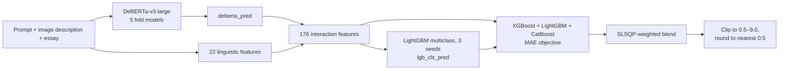

# Automated Essay Scoring (AES) System for IELTS Writing
### 🏆 1st Place Solution (Team Mango) – PTNK AI Challenge (PAIC 2026)

This repository contains the notebook Team Mango used to win PAIC 2026: [`notebooks/PAIC2025.ipynb`](notebooks/PAIC2025.ipynb). It scores IELTS Writing Task 1 and Task 2 essays on the official band scale, up to 9.0, in half-band steps.

The model is a hybrid. A fine-tuned `DeBERTa-v3-large` reads the prompt and the essay and predicts a band. That prediction, 22 hand-engineered linguistic features and their interactions feed an ensemble of gradient-boosted trees (XGBoost, LightGBM, CatBoost).

## 📊 Result
* **Metric:** Mean Absolute Error (MAE)
* **Local 5-fold CV MAE:** `0.4150`. This is the out-of-fold MAE of the weighted ensemble, measured before half-band rounding.

## 🗺️ Pipeline at a glance



The notebook has four code cells, run in order on Kaggle with a GPU. Every stage uses the same 5-fold `StratifiedKFold` split (seed 42, stratified by band).

---

## 🧠 How the notebook works

### Cell 1: DeBERTa predictions and linguistic features
**Data.** `public_train.csv` and `private_train.csv` are merged into a single training set. Rows missing a prompt, an essay or a score are dropped.

**Input text.** `PROMPT: … [SEP] ESSAY: …`. For Task 1, the chart's image description is inserted as `IMAGE: …` between the two. Texts are truncated to 640 tokens.

**Model.** `microsoft/deberta-v3-large`, followed by attention pooling over the last hidden states, followed by a linear head with **16 outputs**.

**Ordinal decoding.** The scale from 1.0 to 9.0 in half-band steps has 17 bands, separated by 16 thresholds. Output *k* (k = 0, …, 15) is read through a sigmoid as the probability that the essay scores above 1.0 + 0.5k. The predicted band is

$$\hat{y} = 1.0 + 0.5 \sum_{k=0}^{15} \sigma(z_k)$$

If every probability is near 0, the prediction is 1.0. If every probability is near 1, it is 1.0 + 0.5 × 16 = **9.0**. Each output is a separate yes/no decision, which is why the model uses a sigmoid on each output rather than a softmax across them.

**Out-of-fold predictions.** Each of the five fine-tuned fold models predicts the essays in its own validation fold. These predictions become the `deberta_pred` feature for the training set. Test predictions are the average of the five models.

**Linguistic features (22).**
* **Length and structure:** characters, words, sentences, paragraphs.
* **Punctuation:** counts of question marks, exclamation marks, semicolons and quotes.
* **Readability:** Flesch Reading Ease, Gunning Fog, SMOG, average sentence length, number of complex (3+ syllable) words.
* **Vocabulary:** unique words, type-token ratio, share of words longer than 6 characters.
* **Error proxies:** double spaces, a space before a period or comma, sentences that start with a lowercase letter, immediately repeated words.
* **Prompt relevance:** number and share of prompt words (after removing stopwords) that appear in the essay.

### Cell 2: Interaction features
Eleven key features are expanded: `deberta_pred`, word / sentence / paragraph counts, average sentence length, unique words, complex words, TTR, Flesch, Gunning Fog and SMOG.
* Squared terms: 11 features.
* Pairwise products, A × B: 55 features.
* Pairwise ratios in both directions, A / (B + 1e-6) and B / (A + 1e-6): 110 features.

This adds 176 features. Any infinite or missing value becomes 0.

### Cell 3: Bagged classifier meta-feature
* A LightGBM **multiclass** classifier treats each band as its own class.
* Each fold is trained with three seeds (42, 2024, 777), and their probabilities are averaged.
* The expected band, Σ P(band) × band, becomes the `lgb_cls_pred` feature.

### Cell 4: Final ensemble
* XGBoost, LightGBM and CatBoost regressors are each trained with an MAE objective, learning rate 0.01 and early stopping after 100 rounds.
* **Blending weights:** found with SciPy `minimize` (SLSQP) to minimize out-of-fold MAE. The weights are between 0 and 1 and sum to 1.
* **Post-processing:** predictions are clipped to [0.5, 9.0] and rounded to the nearest half band, `round(x × 2) / 2`. The result is written to `submission_enhanced.csv`.

---

## 🛠️ Running the notebook
1. Open `notebooks/PAIC2025.ipynb` on Kaggle with a GPU.
2. Attach two inputs:
   * the competition data (`public_train.csv`, `private_train.csv`, `private_test.csv`) under `/kaggle/input/ieltsdata/`;
   * the five fine-tuned DeBERTa fold models (`model_fold_0.pth` … `model_fold_4.pth`) under `/kaggle/input/large-sigma-private/`.
3. Run the four cells in order. The last cell writes `submission_enhanced.csv`.

To run outside Kaggle, change the `/kaggle/...` paths at the top of each cell, then install the dependencies:
```bash
git clone https://github.com/s4dz/ielts-essay-scoring-paic2025.git
cd ielts-essay-scoring-paic2025
pip install -r requirements.txt
```

## 📂 Repository layout
| Path | Contents |
| :-- | :-- |
| `notebooks/PAIC2025.ipynb` | **The competition notebook.** Everything described above |
| `data/sample_essays.csv` | A sample showing the input format |
| `requirements.txt` | Python dependencies |
| `src/`, `main.py` | An unfinished refactor of the notebook into modules. `src/features.py` is complete; the other modules are still empty, so `main.py` does not run yet |
| `notebooks/deberta_training_dev.ipynb` | An earlier DeBERTa training experiment. It is not the run that produced the competition weights |

## ⚠️ Limitations
* The notebook that fine-tuned the five DeBERTa fold models is not in this repository yet. The weights, and the competition data, are also not distributed here. From this repository, only inference with existing weights and the tabular stages can be reproduced.
* The MAE above is measured before the final rounding to half bands.

---

Part of Team Mango's winning entry at PAIC 2026 (January 2026). Repository maintained by Khoa Phan.
